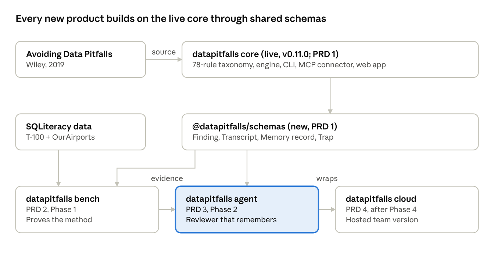

# datapitfalls product specs

datapitfalls is growing from a single checker into a small family of tools for trustworthy AI-assisted analysis. Each product's spec (PRD) lives in the repo that builds it.

| Spec | Product | What it is |
| --- | --- | --- |
| [PRD 1](PRD-1-core.md) | datapitfalls (this repo) | Changes to the core package so the new products can build on it: shared schemas, a transcript input mode, stable rule IDs |
| [PRD 2](https://github.com/bjonesdataliteracy/datapitfalls-bench/blob/main/docs/PRD.md) | [datapitfalls bench](https://github.com/bjonesdataliteracy/datapitfalls-bench) | A public benchmark of analytics-agent memory on changing airline data |
| [PRD 3](https://github.com/bjonesdataliteracy/datapitfalls-agent/blob/main/docs/PRD.md) | [datapitfalls agent](https://github.com/bjonesdataliteracy/datapitfalls-agent) | The reviewer that remembers: memory and review for AI analytics agents |

## Shared principles

1. **Grounded, not guessing.** Every finding, trap and memory cites at least one taxonomy rule ID.
2. **Store what cannot be re-observed.** Memories hold quirks, tested hypotheses, lessons and decisions, never values a fresh query returns.
3. **Humans approve memory.** Changes to shared memory arrive as reviewable diffs.
4. **Local-first.** Free tools run entirely in the user's environment.
5. **Neutral across vendors.** Adapters for Claude, Hex and a generic JSON format; nothing assumes one BI tool or model provider.
6. **Small injected context.** What every session preloads stays under about 200 lines.
7. **One brand, one schema set.** Shared contracts ship once, in `@datapitfalls/schemas`.
8. **Clear licensing.** Code is MIT; the taxonomy is CC BY-NC 4.0 (see [LICENSE-TAXONOMY.md](../../LICENSE-TAXONOMY.md)).
